<!--
  ♠ Profil : as de pique.

  Tout ce qui s'affiche ici est du SVG pur, animé en CSS : un README n'exécute
  aucun JavaScript et ne charge aucune police. Le texte des images est donc
  dessiné en tracés (tools/typo.py), identique sur tous les appareils.

  Chaque image existe en quatre versions — bureau ou mobile, sombre ou clair —
  choisies par <picture>. Ce sont les sources « bureau » qui portent la
  condition de largeur : si elle était un jour ignorée, la mise en page bureau
  s'afficherait partout, comme sur n'importe quel profil, au lieu d'une mise
  en page mobile étirée sur un grand écran.

  Statistiques : calculées par tools/build-stats.py, recalculées toutes les
  deux minutes par .github/workflows/records.yml et publiées sur la branche
  « stats » dès qu'un chiffre bouge. Aucun service tiers : chaque carte affiche
  l'heure de son calcul. Héros, garage, signature : tools/build-assets.py.
  Fonctionnement, fraîcheur et limites : voir claude.md.
-->

  <picture>
    <source media="(min-width: 1012px) and (prefers-color-scheme: dark)" srcset="assets/heros-dark.svg">
    <source media="(min-width: 1012px) and (prefers-color-scheme: light)" srcset="assets/heros-light.svg">
    <source media="(prefers-color-scheme: dark)" srcset="assets/heros-m-dark.svg">
    <source media="(prefers-color-scheme: light)" srcset="assets/heros-m-light.svg">
    
  </picture>

> **♠ Pourquoi l’as de pique&nbsp;?** Le dépassement de soi&nbsp;: ne jamais s’installer dans sa zone de confort, se perfectionner un peu plus chaque jour.
>
> Fondateur de **[Classor](https://classor.fr)**.

  <picture>
    <source media="(min-width: 1012px) and (prefers-color-scheme: dark)" srcset="https://raw.githubusercontent.com/FarddownYG/FarddownYG/stats/skyline-dark.svg">
    <source media="(min-width: 1012px) and (prefers-color-scheme: light)" srcset="https://raw.githubusercontent.com/FarddownYG/FarddownYG/stats/skyline-light.svg">
    <source media="(prefers-color-scheme: dark)" srcset="https://raw.githubusercontent.com/FarddownYG/FarddownYG/stats/skyline-m-dark.svg">
    <source media="(prefers-color-scheme: light)" srcset="https://raw.githubusercontent.com/FarddownYG/FarddownYG/stats/skyline-m-light.svg">
    
  </picture>

  <picture>
    <source media="(min-width: 1012px) and (prefers-color-scheme: dark)" srcset="https://raw.githubusercontent.com/FarddownYG/FarddownYG/stats/bord-dark.svg">
    <source media="(min-width: 1012px) and (prefers-color-scheme: light)" srcset="https://raw.githubusercontent.com/FarddownYG/FarddownYG/stats/bord-light.svg">
    <source media="(prefers-color-scheme: dark)" srcset="https://raw.githubusercontent.com/FarddownYG/FarddownYG/stats/bord-m-dark.svg">
    <source media="(prefers-color-scheme: light)" srcset="https://raw.githubusercontent.com/FarddownYG/FarddownYG/stats/bord-m-light.svg">
    
  </picture>

  <picture>
    <source media="(min-width: 1012px) and (prefers-color-scheme: dark)" srcset="assets/r32-dark.svg">
    <source media="(min-width: 1012px) and (prefers-color-scheme: light)" srcset="assets/r32-light.svg">
    <source media="(prefers-color-scheme: dark)" srcset="assets/r32-m-dark.svg">
    <source media="(prefers-color-scheme: light)" srcset="assets/r32-m-light.svg">
    
  </picture>

<b>Sous le capot</b>

 

- **Zéro JavaScript, zéro service tiers.** Un README n’exécute rien&nbsp;: tout ce qui bouge ici est du SVG animé en CSS, et les animations se coupent d’elles-mêmes si vous avez demandé moins de mouvement.
- **Aucune police chargée.** Chaque lettre des images est un tracé, composé par un petit moteur typographique maison (crénage et ligatures compris)&nbsp;: le rendu est le même partout.
- **Quatre versions de chaque image** — bureau ou mobile, sombre ou clair — choisies par le navigateur.
- **Des statistiques calculées ici.** Le calendrier de contributions est relu toutes les deux minutes et les cartes sont republiées dès qu’un chiffre bouge, et au moins une fois par heure&nbsp;; chacune affiche l’heure de son calcul.
- **Un as de pique dessiné par un algorithme.** Champ de distance pour le pourtour, volutes posées à la main, puis une dentelle de spirales empilées jusqu’à remplir chaque vide.

Le code est dans [`tools/`](tools).

  <picture>
    <source media="(min-width: 1012px) and (prefers-color-scheme: dark)" srcset="assets/signature-dark.svg">
    <source media="(min-width: 1012px) and (prefers-color-scheme: light)" srcset="assets/signature-light.svg">
    <source media="(prefers-color-scheme: dark)" srcset="assets/signature-m-dark.svg">
    <source media="(prefers-color-scheme: light)" srcset="assets/signature-m-light.svg">
    
  </picture>

